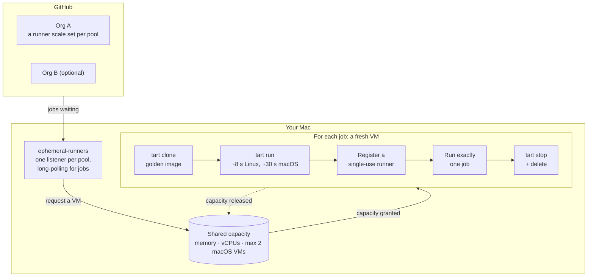

# macos-ephemeral-runners

Self-hosted GitHub Actions runners on an Apple Silicon Mac that behave like
GitHub-hosted ones: every job gets a brand-new VM, and the VM is deleted the
moment the job ends. Nothing a job does survives to the next one, so neither
workflows nor runners clean up after themselves.

Runs macOS and Ubuntu (ARM64) jobs side by side, as many at once as the Mac's
RAM and cores allow. Each **deployment** (an org, repo or enterprise the
runners serve) is one config file that you keep outside this repo, plus a
GitHub App key that lives only on the Mac running it. One Mac can serve
several deployments at once, sharing its capacity between them.

> [!WARNING]
> **Experimental.** This runs KnobanLabs' CI, but it has been tested on few
> machines, its CI runs unit tests only, and GitHub's runner scale set API it
> builds on is in public preview. Read the [security model](#security-model)
> before pointing it at anything important. MIT licensed; no warranty.

## How it works



- **Scale sets:** each pool in a deployment is a
  [runner scale set](https://pkg.go.dev/github.com/actions/scaleset). The
  controller is told exactly how many jobs are waiting, and scales from zero,
  so nothing runs while idle. Set `min_idle` to keep warm VMs instead.
- **Single-use runners:** each VM gets a just-in-time registration that is
  valid for one job. It reaches the VM over stdin, never in argv or a file on
  the host.
- **Teardown:** a VM is destroyed when GitHub reports its job finished, when
  the runner exits, or after `job_timeout`, whichever comes first. VMs left
  over from a crash or power loss are deleted on the next start.
- **Capacity:** every pool of every deployment draws from one memory budget
  and one vCPU budget, both derived from the Mac's hardware unless set. Grants
  are first come, first served across all of them, so a large VM isn't
  starved by smaller ones and an idle org's share goes to a busy one.
  macOS guests are capped at 2 per Mac, Apple's limit. Each slot has a fixed
  MAC address so VM churn can't exhaust the Mac's DHCP leases.
- **Sleep:** the Mac may sleep. VMs pause with it, and the controller
  reconnects to GitHub on wake. Jobs running when it slept may fail if the
  sleep outlasts GitHub's runner timeout.

## Using the runners in a workflow

```yaml
jobs:
  build:
    runs-on: tart-ubuntu-arm64   # a pool name from your deployment's config
```

**Linux is ARM64.** GitHub's `ubuntu-latest` is x86_64; these are closer to
`ubuntu-24.04-arm`. Setup actions pick ARM64 builds automatically, but x86-only
binaries and Docker images won't run. Rosetta can run x86_64 Linux binaries:
add `run_args = ["--rosetta", "rosetta"]` to the pool.

**Private repos only.** Don't let public repositories use these runners; see
the [security model](#security-model).

## Sizing

The example pools give each VM the vCPUs and memory of GitHub's
[standard hosted runner](https://docs.github.com/en/actions/reference/runners/github-hosted-runners)
for a private repository, so a job that fits one fits the other:

| Pool | Like | vCPU | Memory | Disk |
|---|---|---|---|---|
| macOS | `macos-latest` (arm64) | 3 | 7 GB | the image's, 140 GB |
| Ubuntu | `ubuntu-24.04-arm` | 2 | 8 GB | 80 GB (`disk_gb`) |

GitHub lists 14 GB of disk for both. Tart can grow an image's disk but not
shrink it, and both images are larger than that already, so disks stay as
they are. Clones are copy-on-write, so a large disk costs the Mac only what a
job writes.

Matching covers counts, not speed: a vCPU here is one of your Mac's cores,
which may be faster or slower than the M1 cores (macOS) or the server cores
(Linux) GitHub uses. A job whose timing depends on CPU speed can still pass
on one and fail on the other. Set `cpu` and `memory_mb` per pool to size VMs
differently.

## What lives where

| Thing | Location | In git? |
|---|---|---|
| Controller source, launchd plist template, scripts | this repo | yes |
| Deployment configs (org, App IDs, pools) | wherever you keep them; see [Where to keep deployment configs](#where-to-keep-deployment-configs) | not in this repo |
| Installed deployments | `~/.config/ephemeral-runners/deployments/<name>.toml` | copies `install.sh` makes |
| Host settings (optional) | `~/.config/ephemeral-runners/host.toml`, from `host.example.toml` | no; per machine |
| GitHub App private keys | `~/.config/ephemeral-runners/keys/<name>.pem` | **never**; `*.pem` is ignored |
| Controller binary | `~/.local/bin/ephemeral-runners` | built by `install.sh` |
| LaunchAgent | `~/Library/LaunchAgents/local.ephemeral-runners.plist` | rendered by `install.sh` |
| Golden images | `~/.tart/cache` (about 93 GB for the default two) | pulled from ghcr.io |
| Logs | `~/Library/Logs/ephemeral-runners.log` | no |

On GitHub, a deployment is the org's GitHub App plus one runner scale set per
pool. The controller creates the scale sets on first run and reuses them by name
afterwards, so workflows don't change when the Mac or the maintainer does.

## Setting up a Mac

### Requirements

- **Apple Silicon.** Tart uses Apple's Virtualization.framework.
- **A host macOS at least as new as the macOS image.** The default image is
  macOS 26 (Tahoe), and a host can't run a newer macOS guest than itself.
- **Disk:** about 93 GB for the default images, plus room for running jobs.
  Clones are copy-on-write, so each job costs only what it writes. 250 GB free
  is comfortable. Deployments that use the same images share them.
- **RAM:** 7 GB per macOS job and 8 GB per Ubuntu job, plus 8 GB for the host.
  24 GB is a practical minimum; see [Capacity](#capacity).
- **Tart 2.29.0 or later.** VMs start with `--no-keyboard` and `--no-pointer`,
  which older versions lack.
- Homebrew and Go (`brew install go`).
- A logged-in user session. The controller is a LaunchAgent and runs only while
  its user is logged in. On a headless Mac, turn on automatic login for that
  user (System Settings → Users & Groups; requires FileVault off).

### Steps

1. **Install Tart and pull the images** your deployments use. The macOS image
   is about 73 GB.

   ```bash
   brew tap openai/tools
   brew trust --formula openai/tools/tart openai/tools/softnet
   brew install openai/tools/tart
   tart pull ghcr.io/cirruslabs/ubuntu-runner-arm64:24.04
   tart pull ghcr.io/cirruslabs/macos-tahoe-xcode:latest
   ```

   Then let Softnet, which keeps VMs off your local network (see the
   [security model](#security-model)), set up VM networking. It needs root
   for that, and drops it straight after:

   ```bash
   s=$(readlink -f "$(command -v softnet)") && sudo chown root:wheel "$s" && sudo chmod u+s "$s"
   ```

   Repeat this after `brew upgrade` installs a new Softnet. Until you do,
   `ephemeral-runners check` (and so `install.sh`) fails with this command,
   and the controller won't start isolated pools.

2. **Get the repo.**

   ```bash
   gh repo clone KnobanLabs/macos-ephemeral-runners && cd macos-ephemeral-runners
   ```

3. **Get a deployment config.** Use your existing one, or copy
   `config.example.toml` to `<name>.toml` outside this repo (`<name>`:
   lowercase letters and digits) and fill in the `YOUR-*` values after
   [creating the GitHub App](#creating-the-github-app). See
   [where to keep it](#where-to-keep-deployment-configs).

4. **Give this Mac its own key for each deployment.** GitHub can't download an
   existing key again, so each Mac generates its own. On the app's settings page
   (Org → Settings → Developer settings → GitHub Apps → the app), go to
   **Private keys → Generate a private key**, then save it under the
   deployment's name:

   ```bash
   mkdir -p ~/.config/ephemeral-runners/keys && chmod 700 ~/.config/ephemeral-runners ~/.config/ephemeral-runners/keys
   mv ~/Downloads/<app-slug>.*.private-key.pem ~/.config/ephemeral-runners/keys/<name>.pem
   chmod 600 ~/.config/ephemeral-runners/keys/<name>.pem
   ```

5. **Install and start.**

   ```bash
   ./scripts/install.sh path/to/<name>.toml
   ```

   This builds the controller and checks the new deployment together with any
   already installed (config, keys, images, GitHub access, host budget). Only
   if that passes does it install the config and (re)start the LaunchAgent.
   Pass several configs to install several deployments at once.

6. **Verify.** Copy `examples/smoke_test.yaml` into `.github/workflows/` of a
   **private** repo that can use the runners, and run it with your pool names:

   ```bash
   gh workflow run smoke_test.yaml -R <org>/<private-repo> -f pools='["<pool-1>", "<pool-2>"]'
   ```

   It runs 3 jobs per pool and fails if any job sees another's files.
   Afterwards `tart list` shows no `eph-*` VMs, and the org's Settings →
   Actions → Runners page lists no leftover runners.

### Creating the GitHub App

Once per org. The app belongs to the org, not to a person, so it outlives any
one maintainer.

1. Org → Settings → Developer settings → GitHub Apps → **New GitHub App**
   (`https://github.com/organizations/<org>/settings/apps/new`).
   - **Homepage URL:** this repo's URL.
   - **Webhook:** uncheck **Active**. The controller polls GitHub, so it needs
     no webhook.
   - **Permissions → Organization → Self-hosted runners:** Read and write.
     Nothing else.
   - **Where can this app be installed:** Only on this account.
   - Optional: upload `assets/app-icon.png`; badge color `#1E293B`.
2. **Create**, then note the **Client ID**.
3. **Install App** on the org. Repository selection doesn't matter; runners
   are registered for the whole org. The installation ID is the number at the
   end of the URL afterwards (`.../settings/installations/<id>`), or:

   ```bash
   gh api orgs/<org>/installations --jq '.installations[] | select(.app_slug=="<app-slug>") | .id'
   ```

4. Put the Client ID and installation ID in your deployment config. Generate a
   key per Mac as in step 4 above.

For a single repo or a personal account, set `registration_url` to the repo's
URL and give the app the **Repository → Administration: Read and write**
permission instead.

## Where to keep deployment configs

Deployment configs name your org, its GitHub App and your pools. None of that
is secret, but it's yours, so keep it out of public forks of this repo. Either:

- **Only on the Mac.** `install.sh` copies each config to
  `~/.config/ephemeral-runners/deployments/<name>.toml`, and the controller
  needs nothing else. Back that folder up (without `keys/`); to move to another
  Mac, copy the configs across.
- **In a private repo**, for history and review, e.g.
  `deployments/<name>/config.toml` (`install.sh` names that deployment
  `<name>`). Its CI can check the configs without a Mac, credentials or images:

  ```yaml
  - uses: actions/setup-go@b7ad1dad31e06c5925ef5d2fc7ad053ef454303e # v7.0.0
    with:
      go-version: stable
  - run: go run github.com/KnobanLabs/macos-ephemeral-runners@develop validate-config deployments/*/config.toml
  ```

  It's also a good home for the smoke test, which needs a private repo.

## Serving several orgs from one Mac

Install each deployment; the one controller serves them all:

```bash
./scripts/install.sh path/to/acme.toml   # adds acme; deployments already installed stay
```

- **Shared:** the memory and vCPU budgets, the 2-VM macOS cap and the images.
  Whichever org has jobs waiting gets the capacity, first come, first served.
- **Separate:** GitHub App, key, pools and `job_timeout`. VM and runner names
  include the deployment (`eph-acme-tart-ubuntu-arm64-1a2b3c4d`), so each org only
  ever sees its own runners.
- **Pool names** only need to be unique within an org. Two deployments can't
  register the same pool for the same org; `install.sh` rejects that.
- **Removing one** stops serving it and deletes its scale sets from GitHub;
  the others keep running:

  ```bash
  ./scripts/remove-deployment.sh acme
  ```

  Then delete its key (`~/.config/ephemeral-runners/keys/acme.pem`) and the
  matching key on the app's settings page.

## Moving things

**To a new Mac:**
1. On the old Mac, `./scripts/uninstall.sh --purge`. Only one controller can
   listen to a scale set at a time; a second keeps retrying until the first
   stops.
2. On the new Mac, follow [Setting up a Mac](#setting-up-a-mac) with the
   existing deployment configs (from wherever you keep them, or the old Mac's
   `~/.config/ephemeral-runners/deployments/`), generating a new key for each. The budgets
   adapt to the new hardware.
3. Delete the old Mac's keys on each app's settings page. Keys are listed by
   SHA-256 fingerprint; to see which one a Mac uses, run
   `openssl rsa -in ~/.config/ephemeral-runners/keys/<name>.pem -pubout -outform DER | openssl sha256 -binary | base64`.
4. If repurposing the old Mac: `rm -rf ~/.tart ~/.config/ephemeral-runners ~/.local/bin/ephemeral-runners`.

**To a new org:** [create the GitHub App](#creating-the-github-app) there, add
a deployment config for it, and install it alongside the old one. Pool names are just labels; keep the old ones if workflows already use
them. When the old org no longer needs the runners,
`./scripts/remove-deployment.sh <old>` and delete its GitHub App.

**To a new maintainer:** nothing belongs to the previous person. The new
maintainer needs to be an org owner (or a GitHub App manager) to generate keys,
and a user account on the Mac. If the Mac moves to their macOS account, they
generate a key per deployment and run `install.sh` as themselves; the previous
user runs `./scripts/uninstall.sh` first. Then delete the previous keys.

## Security model

Each job runs in its own VM, which is deleted when the job ends, so jobs can't
leave anything behind for later jobs. That's the same isolation GitHub-hosted
runners give. It is **not** a sandbox for untrusted code, and these are the
limits to know:

- **Public repositories:** anyone can open a pull request from a fork, and its
  workflows can target any runner label. Never let public repos use these
  runners. An org's Default runner group blocks public repos unless you allow
  them; keep it that way, and use a private repo for anything that needs the
  runners.
- **The network:** pools default to `network = "isolated"`, Tart's Softnet:
  a VM can reach globally routable IPv4 addresses (the internet) and nothing
  in private ranges, so not your local network, NAS or other machines, and
  not other jobs' VMs. Open specific ranges with `network_allow`. Linux VMs
  can also reach this Mac itself, as their gateway and DNS server, so
  services the Mac offers on all interfaces (AirPlay Receiver, Screen
  Sharing, a dev server on `0.0.0.0`) are reachable from Linux jobs; turn off
  the ones you don't need. macOS VMs can't reach the gateway on Softnet at
  all, so they're pointed at public DNS instead (Cloudflare and Google; set
  `dns` on the pool for others). `network = "shared"` is Tart's plain NAT,
  which reaches everything the Mac can.
- **Inside the VM:** jobs run as an admin user with passwordless sudo, like
  GitHub-hosted runners. The VM's single-use runner registration is readable
  from inside the VM; it is valid only for that one job.
- **On the Mac:** the controller runs as your user, not root. GitHub App keys
  are read from `~/.config/ephemeral-runners/keys/`, mode 600; anyone who can
  read them can register runners for that org. `tart exec` is used only from
  host to guest.
- **VM names:** at startup the controller deletes every Tart VM named
  `<vm_prefix>-*` (`eph-*` by default), assuming they're its leftovers. Don't
  give your own VMs that prefix.
- **Licences you agree to:** Apple's macOS licence limits how many macOS VMs
  you may run and what for, and Tart's licence (FSL) forbids offering it as a
  competing commercial service. Using these for your own CI is the intended
  case; check both for anything else.

Report vulnerabilities privately; see [SECURITY.md](SECURITY.md).

## Capacity

Left unset, the budgets come from the Mac running the controller:

- **Memory:** total RAM minus `host_reserved_mb` (8 GB by default).
- **vCPUs:** 2 × physical cores. VMs rarely keep every vCPU busy, but beyond
  that jobs slow each other down more than extra concurrency helps.

To override either, or the macOS cap, copy `host.example.toml` to
`~/.config/ephemeral-runners/host.toml` and edit it. `ephemeral-runners check`
prints the budget in use. With the example pools (macOS 3 vCPU / 7 GB, Ubuntu
2 vCPU / 8 GB), across all deployments:

| Mac | Budget | Fits at once |
|---|---|---|
| 24 GB, 8 cores | 16 GB, 16 vCPU | 2 macOS, or 1 macOS + 1 Ubuntu, or 2 Ubuntu |
| 36 GB, 14 cores | 28 GB, 28 vCPU | 2 macOS + 1 Ubuntu, or 1 macOS + 2 Ubuntu, or 3 Ubuntu |
| 64 GB, 16 cores | 56 GB, 32 vCPU | 2 macOS + 5 Ubuntu, or 7 Ubuntu |
| 128 GB, 24 cores | 120 GB, 48 vCPU | 2 macOS + 13 Ubuntu, or 15 Ubuntu |

A pool's `max_runners` is an upper bound on top of the budgets. Jobs beyond
what fits wait in GitHub's queue.

## Operating

```bash
tail -f ~/Library/Logs/ephemeral-runners.log              # controller log
tart list                                                 # eph-* VMs are live jobs
~/.local/bin/ephemeral-runners check                      # config, keys, images, budget
launchctl kickstart -k gui/$(id -u)/local.ephemeral-runners   # restart
./scripts/install.sh <path/to/deployment.toml>           # add a deployment or apply changes
./scripts/remove-deployment.sh <name>                     # retire one deployment
./scripts/uninstall.sh [--purge]                          # stop serving everything
```

**Changing a deployment:** edit its config (wherever you keep it) and rerun
`install.sh` with it. Changes made by hand under `~/.config/ephemeral-runners/`
take effect on the next restart.

**Updating images:** `tart pull <image>` again. New jobs use the new image
right away. Prune old layers with `tart prune --entries caches --older-than 14`.

**Stopping gracefully:** with `drain_timeout = "0s"` (the default), stopping
the controller destroys running jobs' VMs at once. Raise it in `host.toml` to
let them finish, and keep the plist's `ExitTimeOut` (180 s) above it.

## License

[MIT](LICENSE). Tart, the VM images and the GitHub Actions runner have
licences of their own.
